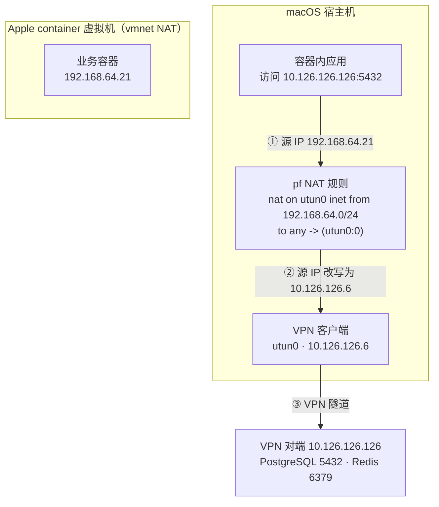

````plain
> 如果你在用 Apple 官方的 `container`，发现容器能上外网、能 ping 通宿主机，但访问不了 VPN 背后的设备——这篇文章讲清楚为什么，以及怎么修。


这个问题影响所有基于 utun 的 VPN：WireGuard、Cloudflare Zero Trust WARP、Cisco Secure Client、Tailscale、EasyTier。我是在把 socat 端口转发从 OrbStack 迁到 Apple container 时撞上的，排查过程绕了不少弯路。这篇文章把完整的推理链和最终解法记录下来，希望能帮到同样卡在这里的人。


## 一分钟快速阅读


**症状** — 容器能上外网、能 ping 通宿主机、甚至能 ping 通宿主机自己的 VPN IP，但访问 VPN 对端 100% 丢包。


**根因** — vmnet 的 NAT 只覆盖发往物理网卡（`enX`）的流量；遇到 VPN 的隧道接口（`utunX`）它直接放行，不改写源 IP。于是容器包带着自己的 `192.168.64.x` 闯进隧道，被 VPN 以"源地址不在虚拟网段"为由丢弃。


**解法** — 用 pf 自己补上这一步 NAT。在 `/etc/pf.conf` 的 `nat-anchor "com.apple/*"` 之后加：


```bash
nat on utun0 inet from 192.168.64.0/24 to any -> (utun0:0)
nat on utun1 inet from 192.168.64.0/24 to any -> (utun1:0)
# ... 依当前最高 utun 编号往下多列几个
```


然后重载：


```bash
sudo pfctl -f /etc/pf.conf
```


`(utun0:0)` 是 pf 取接口主地址的写法，等价于 Linux 的 `MASQUERADE`，一套规则适配多个 VPN。踩坑细节和完整推理见下文。


## 症状：一个很反直觉的现象


假设你的 Mac 通过 VPN 拿到一个虚拟网段，容器要访问 VPN 对端的服务。此时在容器里测试，会得到这样一组结果：


| 测试目标 | 走哪个接口 | 结果 |
|---|---|---|
| 公网 `223.5.5.5:53` | `en0` | ✅ 通 |
| 宿主机网关 `192.168.64.1` | vmnet | ✅ 通 |
| 宿主机自己的 VPN IP `10.126.126.6` | 本地投递 | ✅ 通 |
| **VPN 对端 `10.126.126.126`** | **`utun0`** | ❌ 100% 丢包 |


能上外网、能到宿主机、甚至能到宿主机自己的 VPN IP，唯独到不了 VPN 对端。这个模式很反直觉，也容易把人带偏。


## 先排除几条错路


### 错路一：怀疑 DNS 和路由表


第一反应通常是 DNS 解析失败或者路由缺失。但容器里直接 ping IP 也是 100% 丢包，`route -n get` 显示的默认路由也正常，这条很快就能排除。


真正有用的做法是把上面那张表跑一遍——**它把问题从"网络不通"缩小成了"哪个出口接口不通"**，这是后面所有推理的基础。


### 错路二：找 host 模式


Docker 有 `--network host`，Apple container 呢？实测：


```bash
$ container run --rm --network host ...
Error: network host not found
```


没有。网络只能通过 `container network create` 创建，底层走 `container-network-vmnet` 插件，有两种口味：默认 NAT（`192.168.64.0/24`）和 `--internal` 主机-only。


这是架构决定的：Apple container 每个容器都是一个独立 VM（Virtualization.framework + vmnet.framework），容器和宿主不在同一个网络命名空间，没法像 Linux 容器那样共享宿主网络栈。


顺带一说，**就算有 bridged 模式也救不了这个场景**——bridged 会让容器拿到物理网段 IP（如 `192.168.50.x`），源 IP 依然不在 VPN 虚拟网段里，问题照旧。


### 错路三：让容器自己加入 VPN


容器里 `/dev/net/tun` 是存在的，VPN 的配置也拿得到，看起来可以在容器里跑一个 VPN 节点自己入网。但这会让每个容器都多背一条 VPN 连接，配置和管理都很别扭，不是好方案。


## 根因：vmnet 的 NAT 只认物理网卡


从现象到根因，我是这样一步步推出来的。


**第一步：定位变量。** 同一个容器、同一条默认路由，唯一区别是目的网段走哪个出口接口。走 `en0` 全通，走 `utun0` 全不通——问题一定出在出口接口的处理方式上，而不是 DNS、路由表或 VPN 配置。


**第二步：提出假设。** VPN 通常只接受自己虚拟网段内的源地址。如果容器包保持自己的 IP（`192.168.64.21`）闯进隧道，对端检查源地址不在 `10.126.126.0/24` 内，直接丢弃——这完全符合观察到的"100% 丢包"，而且能解释为什么连 ICMP 都没有任何回应。


**第三步：验证 NAT 有没有发生。** 正常的 NAT 会把源 IP 改写成宿主机地址。但如果真的发生了改写，VPN 就该放行，也就不会有这个问题。现象反过来说明：**这一步改写没有发生**。


**第四步：确认改写缺失的范围。** 容器访问公网是正常的，说明 vmnet 确实会做 NAT——但只对发往物理网卡的流量做。遇到 `utun` 这类隧道接口，它直接把包放出去，不碰源地址。


所以根因是：


> **vmnet 的 NAT 只覆盖发往 `enX`（物理网卡）的流量，不覆盖发往 `utunX`（隧道接口）的流量。**


容器的包带着自己的 IP 直达 VPN，被以"源地址不在虚拟网段"为由丢弃。这也解释了为什么宿主机自己访问 VPN 一直好端端的——它的源地址本来就在虚拟网段里，根本不需要 NAT。


## 解决方案：给每个 utun 加一条 NAT 规则


既然 vmnet 不帮我们做这一步，那就自己补上。在 `/etc/pf.conf` 里、`nat-anchor "com.apple/*"` 之后插入：


```bash
nat on utun0 inet from 192.168.64.0/24 to any -> (utun0:0)
nat on utun1 inet from 192.168.64.0/24 to any -> (utun1:0)
# ... 一直到 utun10
```


```bash
sudo pfctl -f /etc/pf.conf
```


### 关于第一版规则


我第一次写的是这样：


```bash
nat on utun0 inet from ! 10.126.126.6 to 10.126.126.0/24 -> 10.126.126.6
```


规则合法、语法检查通过、成功加载，但完全不生效。调整成上面的写法才通。差异集中在三处：源地址用容器网段正向匹配而不是排除法、目的地址从具体网段放宽到 `any`、NAT 目标从写死的 IP 换成接口主地址。其中第三处是关键，下面细说。


### 三个设计要点


- **`-> (utun0:0)`** 是 pf 里取接口主地址的写法，等价于 Linux 的 `MASQUERADE`。这样每个 utun 用自己的 IP 做源，不需要为每个 VPN 写死不同地址——EasyTier 用 `10.126.126.6`，Cloudflare WARP 用 `100.64.0.250`，一条规则模式全覆盖。这是我最开始没想到的写法，写死 IP 不仅啰嗦，多个 VPN 共存时还会互相干扰。
- **`from 192.168.64.0/24`** 只匹配容器流量，macOS 自身访问 VPN 完全不受影响。用排除法（`from ! <vpn-ip>`）写反而更脆弱。
- **`to any`** 覆盖该 VPN 背后的整个网段，不用逐个列举对端 IP。


### 两个容易踩的细节


**段序。** 规则必须放在 `nat-anchor` 之后、`rdr-anchor` 之前。pf 对段序有严格要求：options → normalization → queueing → **translation** → filtering，把 `nat` 写到 `anchor "com.apple/*"`（过滤段）之后会直接报：


```
/etc/pf.conf:30: Rules must be in order: options, normalization, queueing, translation, filtering
```


**utun 编号。** macOS 的 utun 编号会随重启和 VPN 重连变化，所以列到比当前最高编号再高几个（我当前最高 utun5，列到了 utun10）。pf 对不存在的接口只是规则不生效，不会报错。


### 最终拓扑





数据包源地址的变化是关键：容器发出时是 `192.168.64.21`，被 pf 改写成 `10.126.126.6` 后才进 VPN 隧道，对端就认了。


## 实例：从 OrbStack 迁 socat 到 Apple container


理论说完了，看个完整实例。我原来的需求是：Mac 上的应用要连 `127.0.0.1:6379/5432`，实际服务在 VPN 对端，所以需要一个 socat 做 localhost 转发。


**OrbStack 版本**（迁移前，一直正常工作）：


```yaml
services:
  socat:
    image: alpine/socat:latest
    network_mode: host
    restart: unless-stopped
    command:
      - |
        socat TCP-LISTEN:5432,bind=127.0.0.1,fork,reuseaddr TCP:10.126.126.126:5432 &
        exec socat TCP-LISTEN:6379,bind=127.0.0.1,fork,reuseaddr TCP:10.126.126.126:6379
```


注意它用了 `network_mode: host`，所以 socat 直接共享 OrbStack VM 的网络栈，天然能访问 VPN——这也是为什么 OrbStack 从来没这个问题。


**Apple container 版本**（迁移后，需配合上面的 pf 规则）：


```bash
container run -d --name socat \
  --publish 127.0.0.1:6379:6379 \
  --publish 127.0.0.1:5432:5432 \
  --entrypoint sh alpine/socat:latest -c '
socat TCP-LISTEN:6379,bind=0.0.0.0,fork,reuseaddr TCP:10.126.126.126:6379 &
exec socat TCP-LISTEN:5432,bind=0.0.0.0,fork,reuseaddr TCP:10.126.126.126:5432
'
```


差别在于 socat 内部要绑 `0.0.0.0` 而不是 `127.0.0.1`——因为容器有自己的网络栈，`--publish` 负责把宿主机的 `127.0.0.1` 映射进来。


## 顺带：Apple container 没有 restart 策略


迁完发现两个新问题，和 VPN 无关但值得记录。


**Apple container 没有 restart 策略。** `container run --help` 里找不到 `--restart`，查了下每个容器的 launchd 任务定义：


```bash
$ cat ~/Library/Application\ Support/com.apple.container/containers/socat/service.plist
```


里面 `RunAtLoad` 是 `false`。也就是说容器崩溃或系统重启后不会自己回来。OrbStack 那边一个 `restart: unless-stopped` 就搞定的事，这里得自己补。


好消息是容器**系统**服务是自启的——`com.apple.container.apiserver` 这个 launchd 任务带 `runatload` 属性，开机会自己起来，不需要 `brew services`。


所以只需要一个监管器，定期把容器拉起来：


```bash
#!/bin/bash
# 补偿 apple/container 缺失的 restart 策略
set -uo pipefail


# launchd 的默认 PATH 只有 /usr/bin:/bin:/usr/sbin:/sbin，不含 homebrew
readonly CONTAINER_BIN="/opt/homebrew/bin/container"
readonly CONTAINER_NAME="socat"


while true; do
  # container start 是幂等的：已运行时仅打印名称并返回 0
  if ! "${CONTAINER_BIN}" start "${CONTAINER_NAME}" 2>>/tmp/socat.log; then
    "${CONTAINER_BIN}" run -d --name "${CONTAINER_NAME}" \
      --publish 127.0.0.1:6379:6379 \
      --publish 127.0.0.1:5432:5432 \
      --entrypoint sh docker.io/alpine/socat:latest -c '
socat TCP-LISTEN:6379,bind=0.0.0.0,fork,reuseaddr TCP:10.126.126.126:6379 &
exec socat TCP-LISTEN:5432,bind=0.0.0.0,fork,reuseaddr TCP:10.126.126.126:5432
' 2>>/tmp/socat.log
  fi
  sleep 20
done
```


配一个 LaunchAgent，`RunAtLoad` + `KeepAlive`：


```bash
launchctl load ~/Library/LaunchAgents/com.user.socat-container-supervisor.plist
```


实测效果：`container stop socat` 后 **20 秒**自动恢复，`container rm -f socat` 后 **10 秒**自动重建。


**这里有个巨坑**：第一版监管器我直接写 `container start socat`，在 LaunchAgent 下一直静默失败。查日志才发现：


```
container: command not found
```


launchd 的环境变量是极简集，PATH 只有 `/usr/bin:/bin:/usr/sbin:/sbin`，**不含 `/opt/homebrew/bin`**。必须用绝对路径。这类问题不模拟一次崩溃根本发现不了——所以我特意做了 stop 和 rm 两种故障注入来验证监管器真的在干活，而不是摆着好看。


## 总结


1. **Apple container 只有 NAT 模式**，没有 host / bridged，这是 VM 架构决定的，别浪费时间找开关
2. **vmnet 的 NAT 不覆盖 utun 类接口**，容器包会带着自己的 IP 闯进 VPN 被丢弃
3. **pf 的 `(interface:0)` 是 MASQUERADE 的等价物**，比写死 IP 更优雅，也能一套规则适配多个 VPN
4. **Apple container 没有 restart 策略**，需要自己用 launchd 补偿
5. **launchd 下务必用绝对路径**，并且要真的做故障注入验证


## 注意事项


- pf 那几条 NAT 规则现在是**关键依赖**，删掉容器立刻失去 VPN 访问能力
- 规则里容器网段写死为 `192.168.64.0/24`，如果改了 Apple container 的默认子网需要同步
- utun 列到 `utun10`，将来 VPN 数量超过 11 个才需要扩展
- macOS 大版本更新有可能重置 `/etc/pf.conf`。如果升级后容器突然连不上 VPN 而 macOS 自己能连，先 `grep "nat on utun" /etc/pf.conf` 看看规则还在不在


## 参考


- [apple/container 官方文档](https://apple.github.io/container/documentation/)
````
